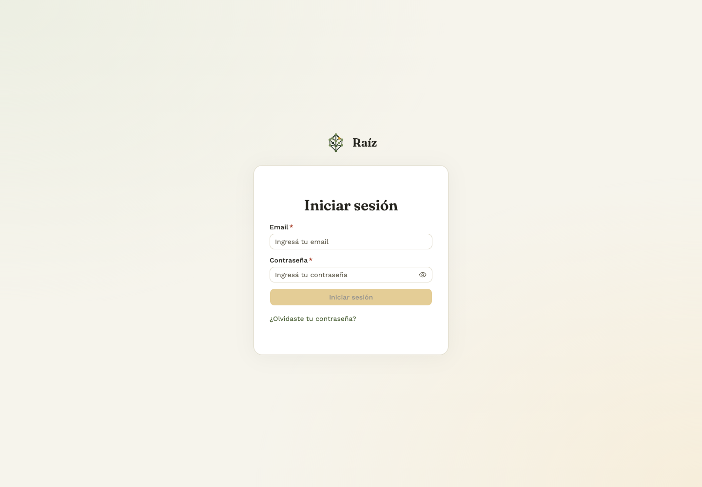
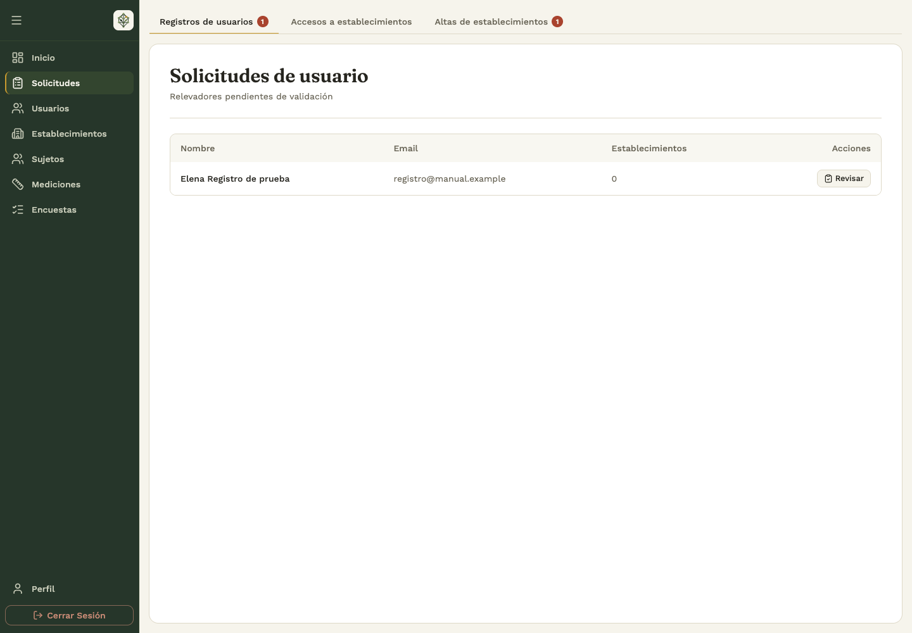
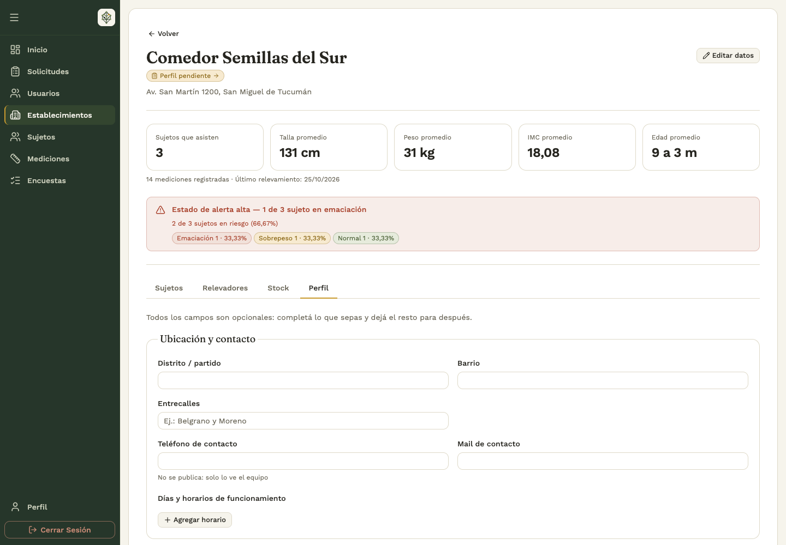
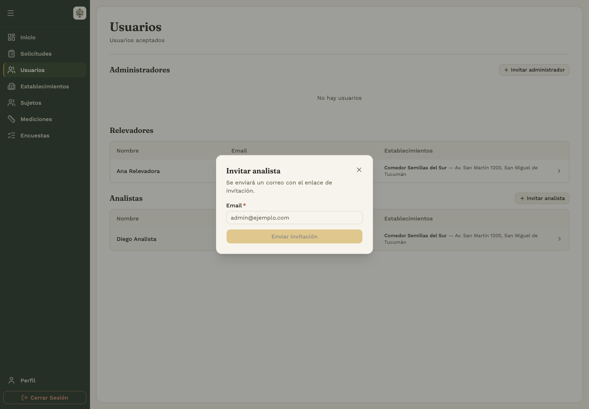
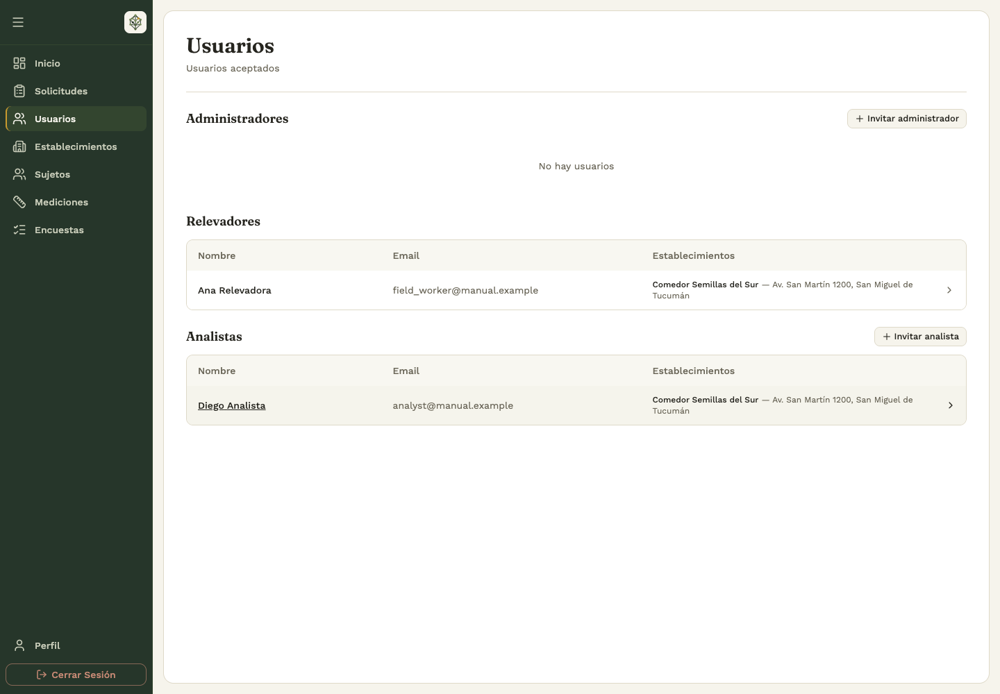
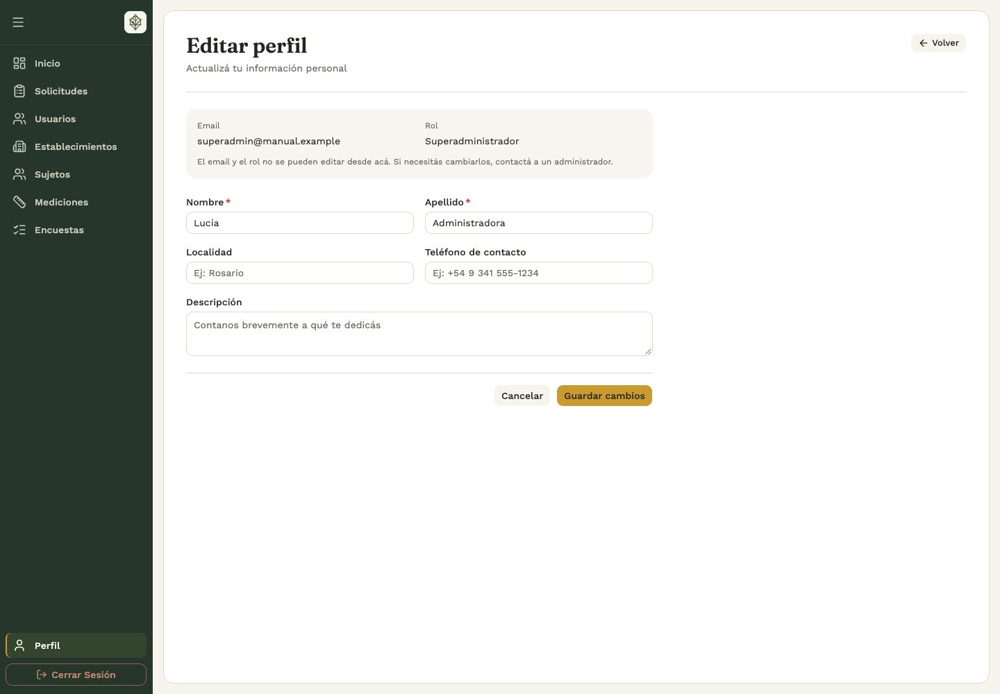

# 1. Acceso y trabajo en equipo

## 1.1 Iniciar sesión y recuperar la contraseña

El backoffice está destinado a administradores y analistas. El menú lateral muestra las secciones disponibles para tu rol. Los relevadores trabajan desde la app móvil.

1. Abrí la página de acceso e ingresá el email y la contraseña.
2. Elegí **Iniciar sesión**.
3. Si recibiste una invitación, abrí primero su enlace, completá tus datos y creá la contraseña para activar la cuenta.
4. Si olvidaste la contraseña, elegí **¿Olvidaste tu contraseña?**, ingresá el email y seguí el enlace del correo.
5. Definí la nueva contraseña según los requisitos del formulario y volvé a iniciar sesión.

Si un enlace venció o ya se usó, solicitá uno nuevo. Si el sistema pide esperar tras varios intentos, respetá el plazo indicado. Si tu cuenta está pendiente, pedí a un administrador que revise el registro.

## 1.2 Aprobar una cuenta y decidir sus accesos

**Quién:** administrador. **Dónde:** backoffice → **Solicitudes → Registros de usuarios**.

1. Buscá el registro pendiente y elegí **Revisar**.
2. Comprobá los datos y el aviso de email sin verificar, si aparece.
3. Decidí qué establecimientos aceptar, cuáles rechazar y cuáles dejar pendientes.
4. Elegí **Aceptar solicitud** y confirmá para activar la cuenta con las decisiones tomadas.
5. Para rechazar el registro completo, elegí **Rechazar solicitud** y confirmá.

Los accesos que dejás sin decidir siguen pendientes. Se resuelven después en **Accesos a establecimientos**. Si se informa una aprobación parcial, revisá esa pestaña antes de dar por terminada la tarea.

## 1.3 Gestionar accesos a establecimientos

**Administrador:** entrá a **Solicitudes → Accesos a establecimientos → Revisar**, aceptá o rechazá cada vínculo y aplicá los cambios. La aprobación de la cuenta y la de cada comedor se administran por separado. Podés quitar un acceso desde la ficha del usuario o desde la pestaña **Relevadores** del comedor.

**Analista:** en **Perfil → Mis establecimientos**, elegí **Solicitar acceso**, buscá por nombre o dirección y enviá la solicitud. Revisá si está pendiente, aprobada o rechazada. Para dejar de trabajar en un comedor, usá la acción de retiro o baja y confirmá.

Los administradores usan **Suscribirme / Desuscribirme** para identificar establecimientos de interés, sin solicitar una aprobación.

## 1.4 Revisar propuestas de establecimientos

**Administrador:** abrí **Solicitudes → Altas de establecimientos** y revisá la propuesta. Al aprobarla, completá o corregí ubicación y datos solicitados. El comedor queda disponible y se otorga el acceso correspondiente a quien lo propuso.

Si el lugar ya existe, el sistema puede reutilizarlo para evitar un duplicado. El rechazo no crea un establecimiento. Una solicitud ya resuelta no se vuelve a aprobar: revisá el estado antes de reintentar.

**Analista:** para proponer un comedor, usá **Establecimientos → Proponer establecimiento** y enviá los datos para su revisión.

## 1.5 Crear, localizar y completar un establecimiento

**Quién:** administrador para el alta y la edición de nombre/dirección. **Dónde:** backoffice → **Establecimientos**.

1. Elegí **Nuevo establecimiento**.
2. Completá el nombre y buscá la dirección.
3. Seleccioná una sugerencia de dirección para fijar la ubicación y verificá ciudad y provincia.
4. Completá la ficha opcional si ya contás con esa información y guardá.
5. Buscá el nuevo registro en la lista y abrilo para revisar sus datos.

La lista permite buscar y ordenar. La vista **Mapa** muestra los establecimientos con ubicación disponible y una leyenda de estados. Si un lugar no aparece en el mapa, revisá la lista y su ubicación.

Desde la ficha, **Editar datos** permite corregir nombre y ubicación. La pestaña **Perfil** permite ver o completar la caracterización: ubicación y contacto, tipo de espacio, servicios, asistentes, alimentación y comunidad.

## 1.6 Invitar usuarios y administrar roles

**Quién:** administrador. **Dónde:** backoffice → **Usuarios**.

1. Abrí la lista de **Administradores** o **Analistas** y elegí la acción de invitación.
2. Ingresá el email y enviá la invitación.
3. La persona abre el enlace, completa sus datos y crea su contraseña para activar la cuenta.
4. Si no la recibió, usá **Reenviar invitación** cuando la pantalla lo permita.

Si el email ya tiene una cuenta, el panel informa esa situación. Una invitación pendiente no equivale a una cuenta activada.

Abrí un usuario para ver su perfil, estado y establecimientos. **Cambiar rol** ofrece únicamente los roles que tu cuenta puede asignar. Un administrador no puede cambiar el rol de otro administrador ni del superadministrador; el superadministrador dispone de permisos adicionales. No podés cambiar tu propio rol desde ese diálogo.

## 1.7 Editar el perfil y cerrar sesión

En **Perfil → Editar perfil**, modificá los datos habilitados y guardá. El email y el rol son datos de consulta. Para salir del panel, elegí **Cerrar sesión**. Si tu sesión vence, volvé a ingresar antes de continuar.

