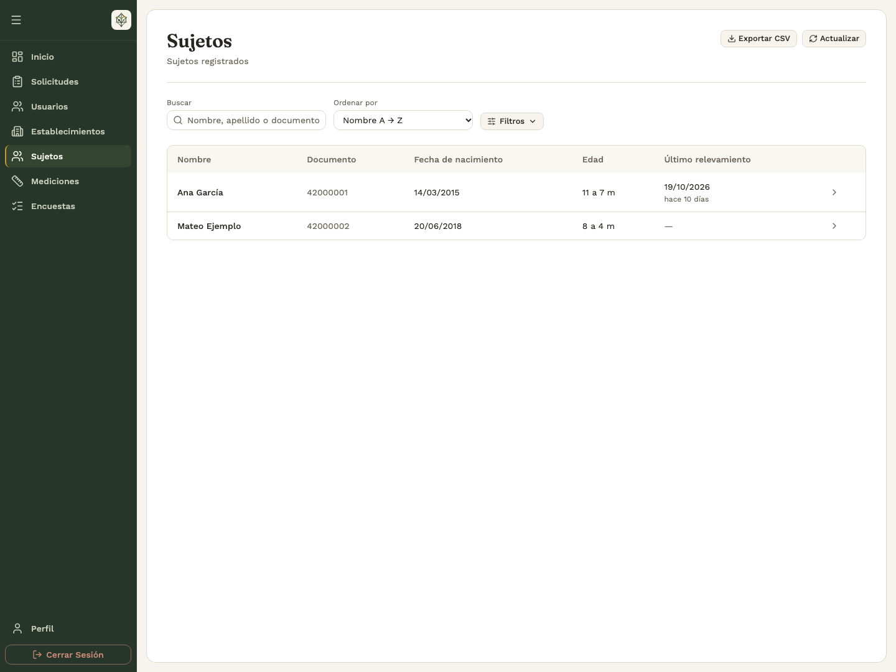
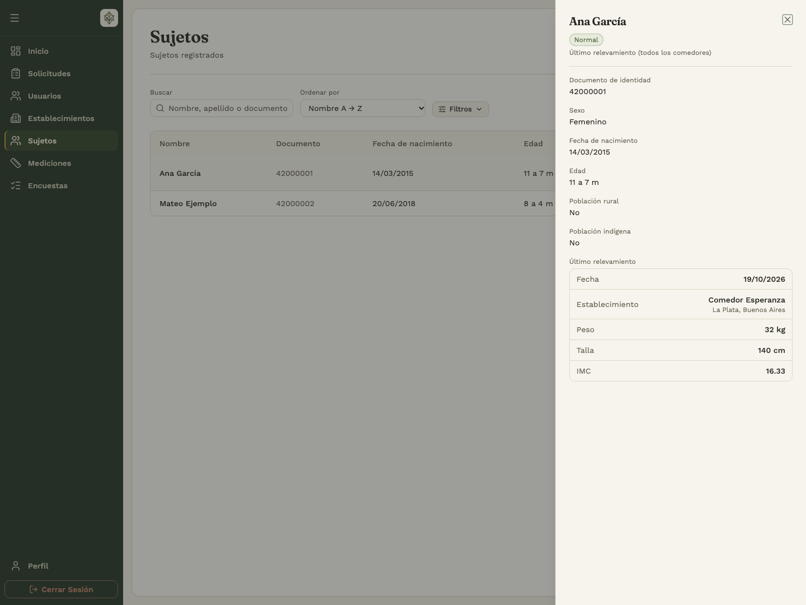
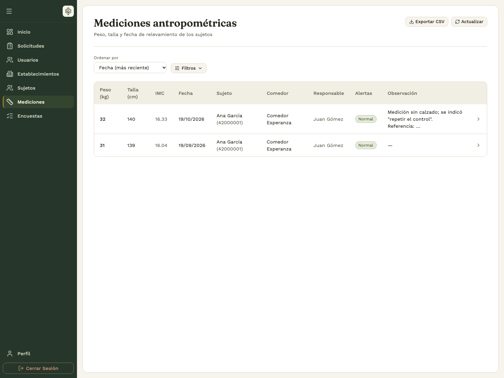
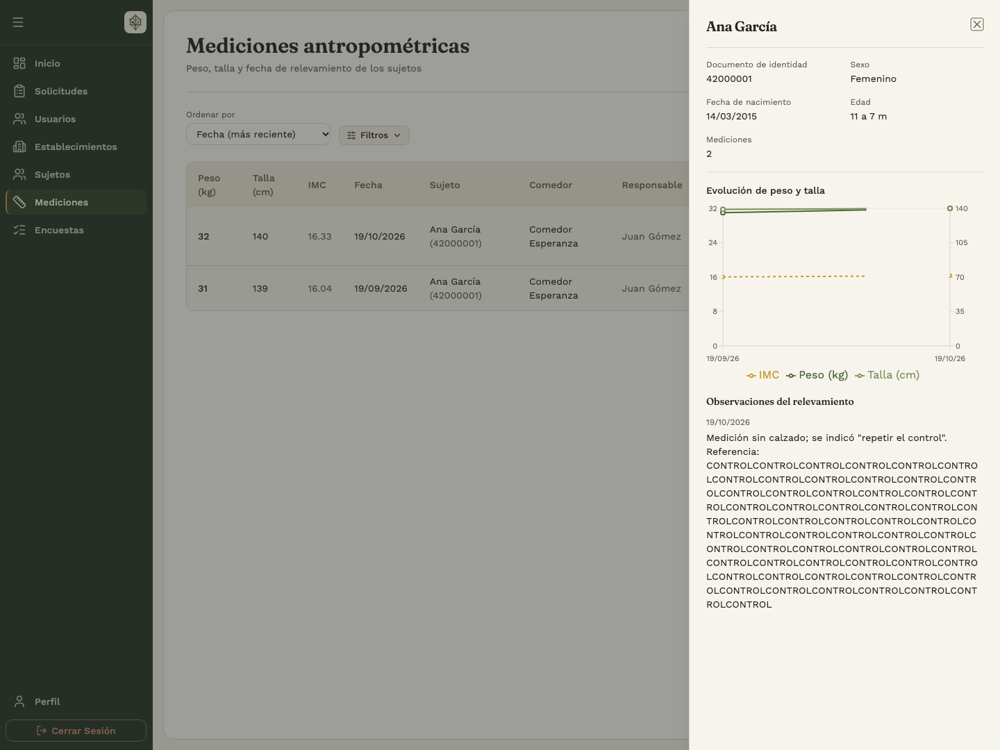
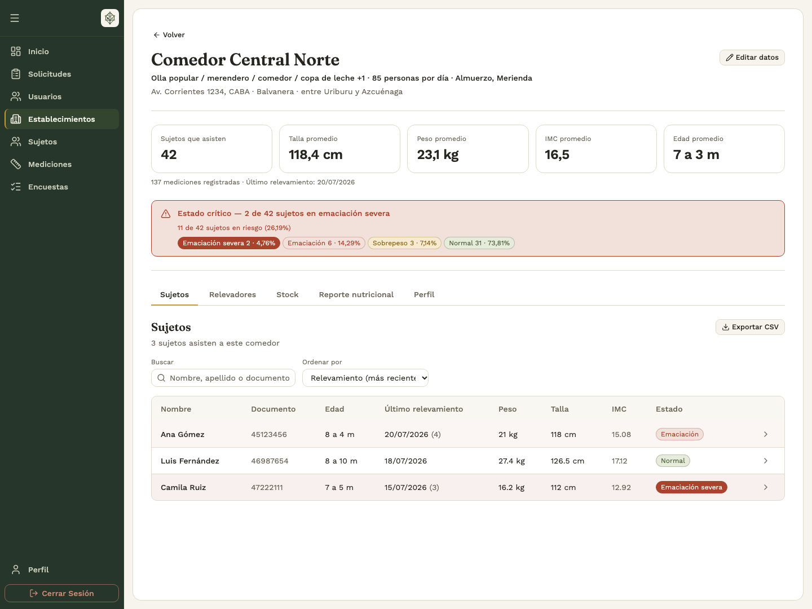

# 2. Talla y Peso

## 2.1 Consultar sujetos desde el backoffice

**Quién:** analista o administrador. **Dónde:** **Sujetos**.

1. Buscá por nombre, apellido o documento.
2. Abrí **Filtros** para acotar por fecha de nacimiento, establecimiento, zona rural, población indígena o sexo.
3. Revisá **Edad** y **Último relevamiento**. La edad corresponde al día de la consulta; el último relevamiento muestra su fecha y cuánto tiempo pasó.
4. Ordená el listado y cambiá de página si hace falta.
5. Abrí la fila de una persona para ver sus datos, edad actual y último relevamiento.

La edad se expresa en años y meses completos: por ejemplo, **7 a 3 m** significa 7 años y 3 meses. La edad actual puede ser distinta de la edad que tenía la persona al tomar una medición anterior. Una raya (**—**) indica que no hay un dato disponible para ese campo. Si no hay mediciones, el último relevamiento aparece sin fecha.

En el listado general, el último relevamiento puede pertenecer a cualquiera de los comedores. En la ficha de un establecimiento, la lectura de sus sujetos se refiere al último relevamiento **en ese comedor**. Comprobá el contexto antes de comparar las dos pantallas.

## 2.2 Consultar mediciones y evolución

**Dónde:** backoffice → **Mediciones**.

1. Revisá peso, talla, IMC, fecha, sujeto, comedor, responsable, alertas y observaciones.
2. Usá los filtros de fechas, edades y ubicación que muestra la pantalla para acotar la búsqueda.
3. Elegí el orden que te resulte útil y tocá **Actualizar** para consultar las últimas cargas.
4. Abrí una fila para ver la **Evolución** de esa persona, su edad actual, el gráfico de peso, talla e IMC y las observaciones disponibles.

Si una carga de la app no aparece, revisá primero que esté sincronizada y después comprobá filtros, fechas y establecimiento. Un rango con la fecha inicial posterior a la final, o la edad mínima mayor que la máxima, debe corregirse antes de consultar.

## 2.3 Revisar el establecimiento y exportar

En **Establecimientos**, abrí el comedor. La cabecera resume sus sujetos, promedios, último relevamiento y estado de alerta. La pestaña **Sujetos** permite revisar los registros que componen ese contexto.

**Sin datos** significa que todavía no hay información suficiente para mostrar esa lectura; no equivale a un resultado «Normal».

Las acciones **Exportar CSV** de establecimientos, sujetos y mediciones descargan el listado correspondiente. Configurá primero los filtros y comprobá el archivo descargado. En el CSV general de sujetos también se incluyen la edad actual, la fecha del último relevamiento y el tiempo transcurrido desde esa medición. La edad y el tiempo se calculan al descargar: un archivo guardado no se actualiza por sí solo.

La exportación sirve para continuar el trabajo fuera del panel; la consulta del sistema sigue mostrando las actualizaciones posteriores.

