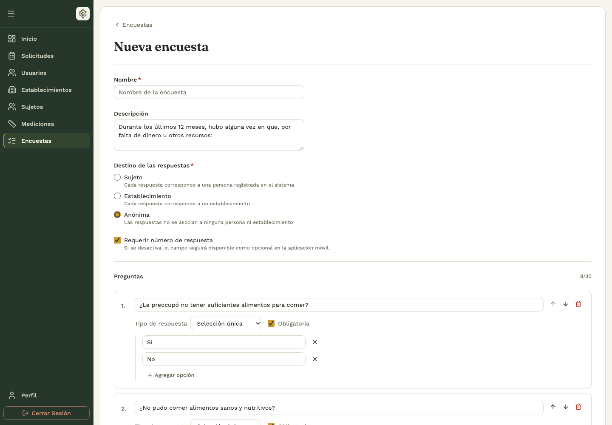
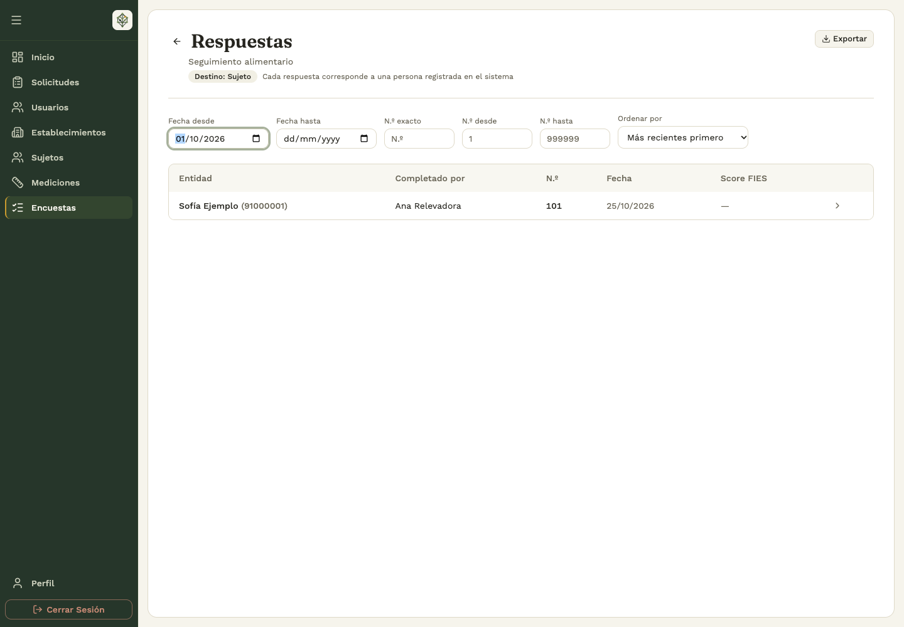

# 3. Encuestas

## 3.1 Crear una encuesta personalizada

**Quién:** administrador o analista. **Dónde:** backoffice → **Encuestas → Crear encuesta**.

1. Completá **Nombre** y, si corresponde, **Descripción**.
2. Elegí el **Destino de las respuestas**:
   - **Sujeto:** cada respuesta se vincula a una persona registrada.
   - **Establecimiento:** cada respuesta corresponde a un comedor.
   - **Anónima:** no se asocia a una persona ni a un establecimiento.
3. Decidí si vas a **Requerir número de respuesta**. Aunque sea opcional, la app conserva el campo.
4. Escribí cada pregunta y elegí su tipo: **Texto libre**, **Selección única**, **Selección múltiple**, **Numérica** o **Fecha**.
5. Marcá **Obligatoria** cuando corresponda. Para preguntas de selección, agregá las opciones necesarias.
6. Usá **Agregar pregunta** para completar el formulario y tocá **Guardar**.

La encuesta admite hasta 30 preguntas. El nombre debe distinguirla de las existentes. Una pregunta de selección necesita opciones; una pregunta de texto, número o fecha no usa una lista de opciones.

## 3.2 Partir de la plantilla FIES

Desde la creación de encuestas, elegí la opción de plantilla **FIES** que ofrece el panel. Revisá las preguntas precargadas, completá el nombre del relevamiento y guardá.

FIES es un instrumento específico: si necesitás conservar su evaluación, mantené la estructura y las respuestas previstas por la plantilla. Para otro cuestionario, usá una encuesta personalizada. El **Score FIES** se consulta cuando corresponde a las respuestas de ese instrumento; no es una puntuación genérica para cualquier encuesta.

## 3.3 Activar, desactivar, duplicar y eliminar

**Dónde:** backoffice → **Encuestas → Más acciones** de la fila correspondiente.

Los administradores pueden modificar cualquier encuesta. Un analista puede modificar las que creó; para cambiar una de otra persona debe coordinar con su autor o con un administrador. La eliminación desde el backoffice está reservada a administradores.

| Acción         | Resultado y precaución                                                                                                  |
| -------------- | ----------------------------------------------------------------------------------------------------------------------- |
| **Activar**    | La encuesta queda habilitada para recibir respuestas. Confirmá la acción.                                               |
| **Desactivar** | Deja de aceptar nuevas respuestas; sus resultados anteriores siguen siendo consultables.                                |
| **Duplicar**   | Crea otra encuesta para preparar un nuevo relevamiento. Revisá el nombre, contenido y estado de la copia.               |
| **Editar**     | Abre su configuración. Con respuestas registradas se aplican restricciones.                                             |
| **Eliminar**   | Disponible según permisos y condiciones. Una encuesta con respuestas no se elimina. Confirmar el borrado es definitivo. |

Para cambiar el instrumento de un relevamiento ya iniciado, prepará una nueva encuesta o duplicala en lugar de alterar el significado de respuestas existentes.

## 3.4 Editar después de recibir respuestas

El formulario muestra un aviso cuando la encuesta ya tiene respuestas. En ese estado no se puede cambiar el destino ni la obligatoriedad del número, eliminar preguntas, cambiar su tipo, volver obligatoria una pregunta opcional o agregar preguntas nuevas obligatorias. El panel también restringe la eliminación de opciones existentes.

Si alguien respondió mientras editabas y el guardado informa un conflicto, recargá la encuesta y revisá las restricciones actuales. No repitas el guardado de una configuración anterior sin revisar el mensaje.

## 3.5 Consultar resultados y exportarlos

**Dónde:** backoffice → **Encuestas → Ver respuestas**.

1. Revisá el destino de la encuesta y la cantidad de respuestas.
2. Usá los filtros de fecha, ubicación, entidad, persona que completó y número de respuesta disponibles para ese relevamiento.
3. Para números, elegí búsqueda exacta o por intervalo; el valor «desde» no puede superar al valor «hasta».
4. Abrí una respuesta para consultar sus preguntas y respuestas completas.
5. Usá **Exportar** para descargar las respuestas en un archivo Excel (`.xlsx`).
6. Comprobá el archivo descargado y que corresponde a la selección filtrada.

La pantalla **Inicio** del backoffice reúne indicadores generales, como cantidad de respuestas y último relevamiento. La ausencia de resultados puede deberse a filtros, a que todavía no hubo respuestas o a que la app no terminó de sincronizar.

