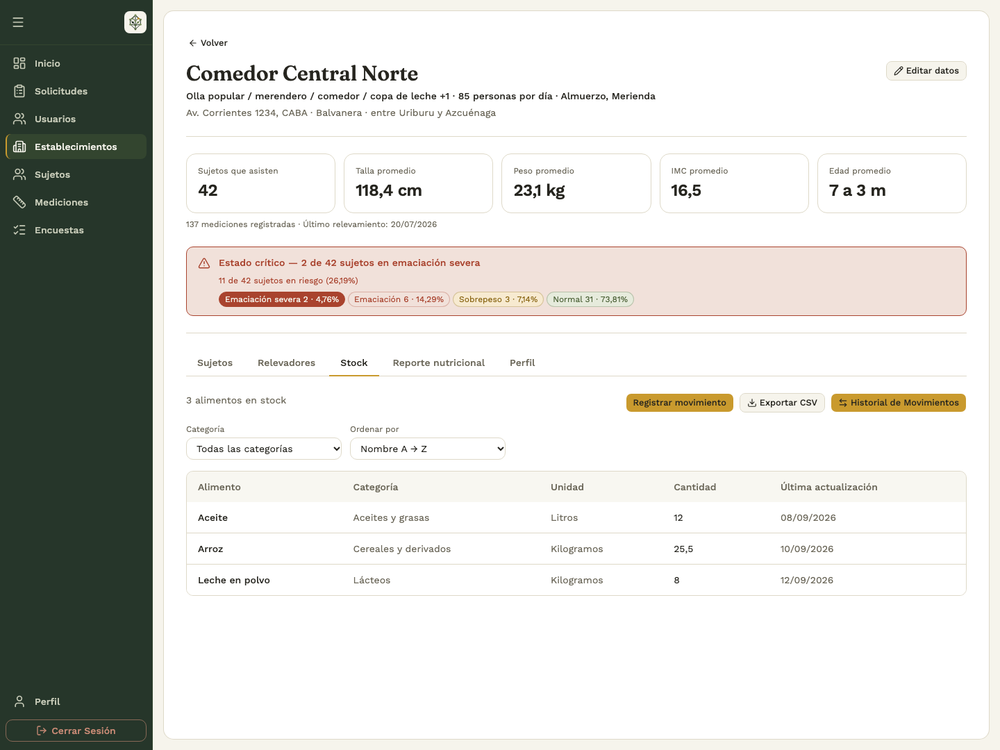
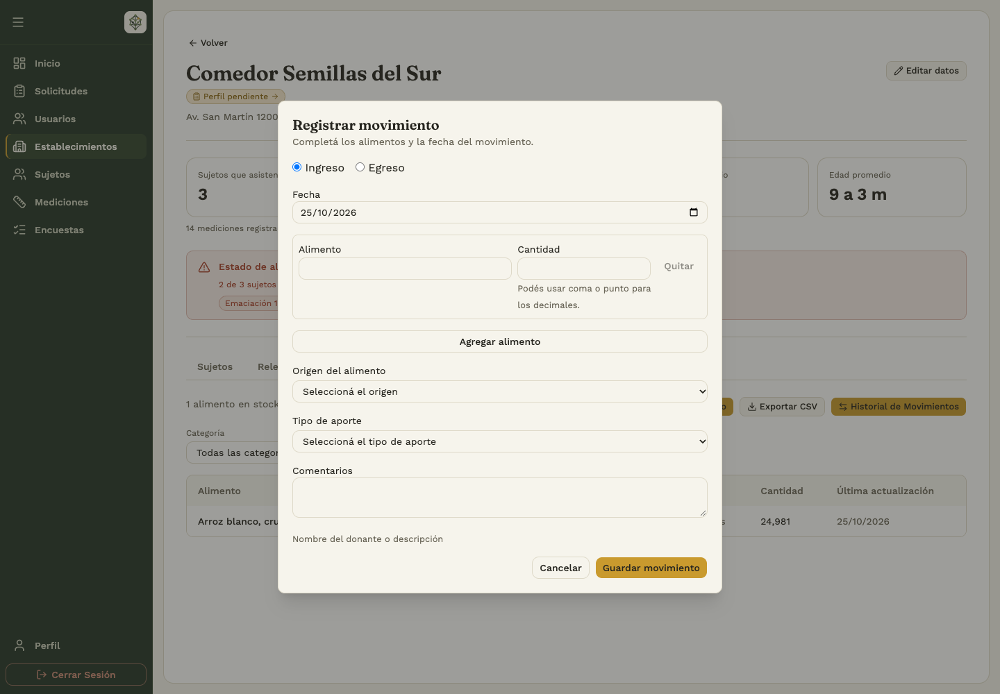
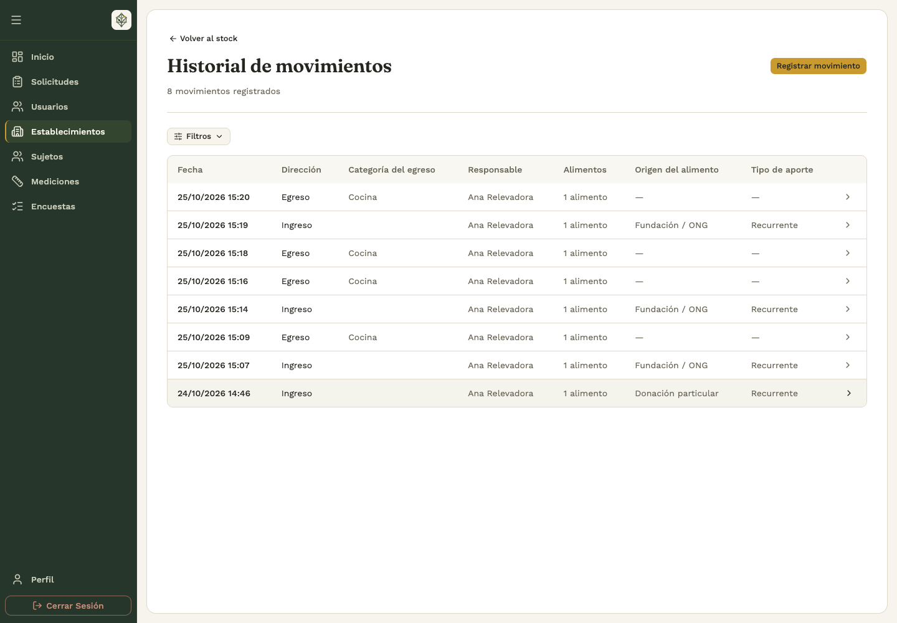

# 4. Nutrir

## 4.1 Consultar existencias

Abrí **Establecimientos → comedor → Stock**. La tabla muestra cantidades, categorías, unidades y última actualización. Aplicá los filtros y usá **Exportar CSV** para descargar la consulta. Verificá el comedor antes de registrar movimientos.

El catálogo determina la unidad: kilogramos, litros o unidades. Registrá cada cantidad en la unidad indicada. Si una consulta no muestra alimentos, quitá los filtros y revisá si hay existencias.

## 4.2 Registrar movimientos desde el backoffice

**Quién:** administrador o analista con acceso a las acciones correspondientes. **Dónde:** ficha del establecimiento → **Stock → Registrar movimiento**.

1. Elegí si se trata de un ingreso o un egreso de stock.
2. Completá fecha, alimentos, cantidades y comentarios según el formulario.
3. Si el movimiento es un egreso, especificá hacia dónde va el stock. Si es un ingreso, indicá de dónde proviene y aclará si es un aporte único o recurrente.
4. Hacé clic en **Guardar movimiento** y andá al **Historial de Movimientos**, donde podés hacer clic sobre el registro para verificarlo y ver todo su detalle.

Si se informa que el movimiento ya estaba registrado, abrí el guardado y revisalo antes de volver a cargarlo.

## 4.3 Consultar historial y detalle

En la ficha del establecimiento, elegí **Stock → Historial de Movimientos**.

1. Filtrá por dirección del movimiento, fechas, alimento y las opciones disponibles.
2. Comprobá que la fecha inicial no sea posterior a la final.
3. Abrí un ingreso o egreso para revisar fecha, responsable, comentarios, alimentos, cantidades y unidad.
4. Si no encontrás un movimiento, quitá los filtros y comprobá el establecimiento.

