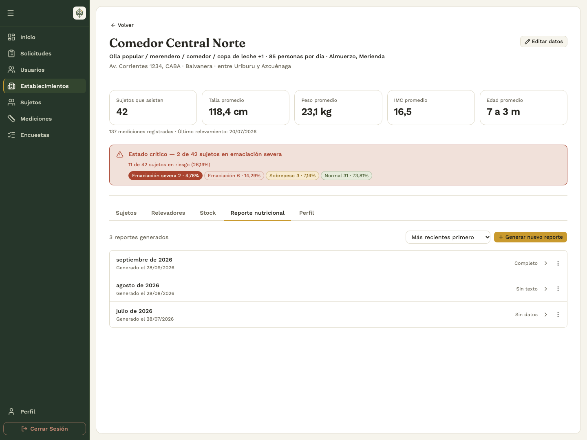
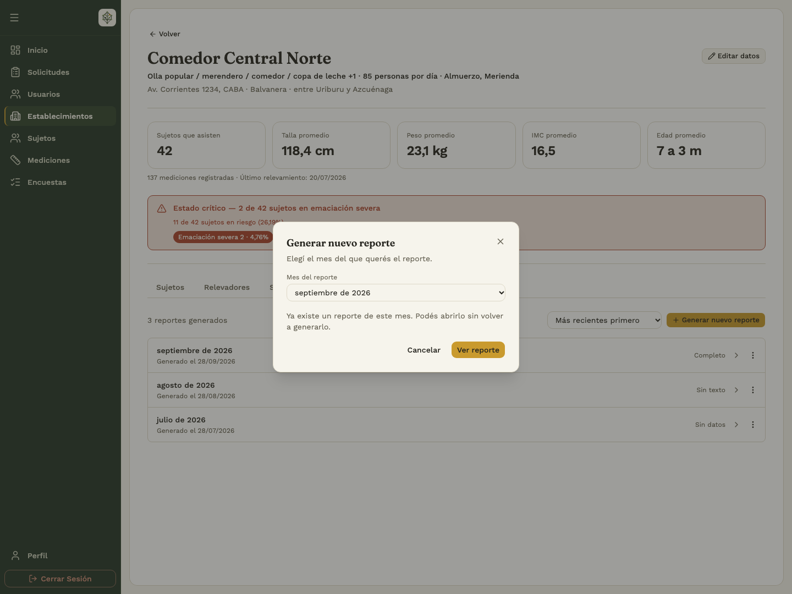
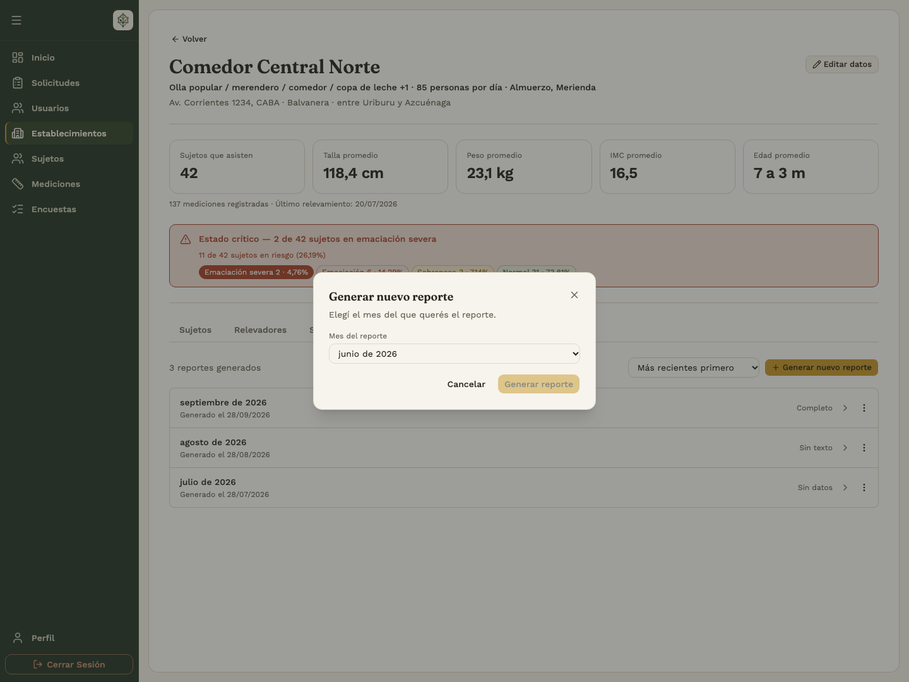
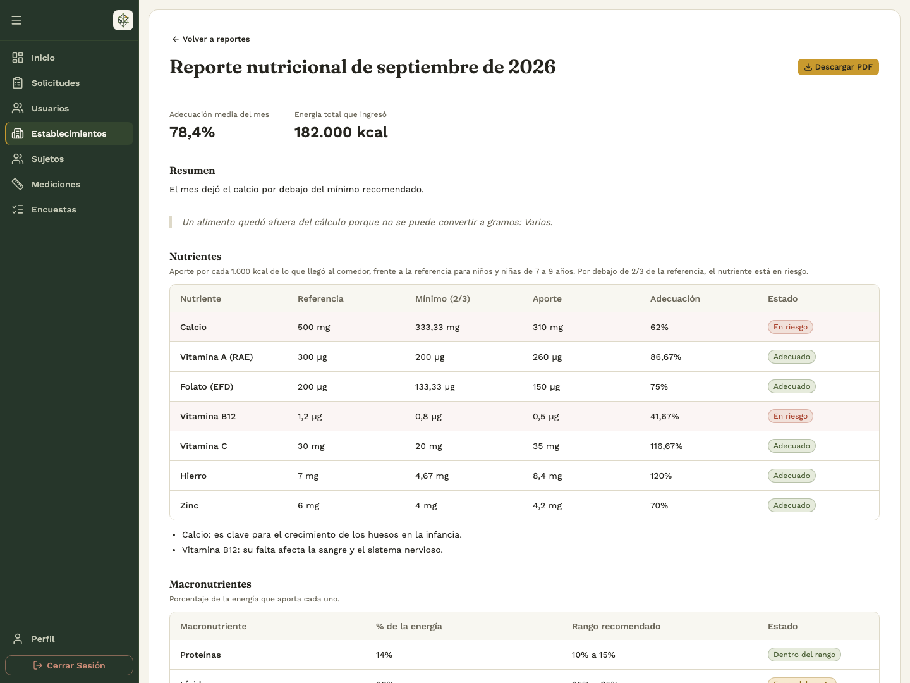
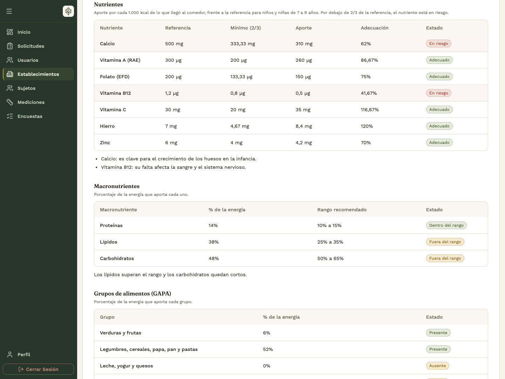
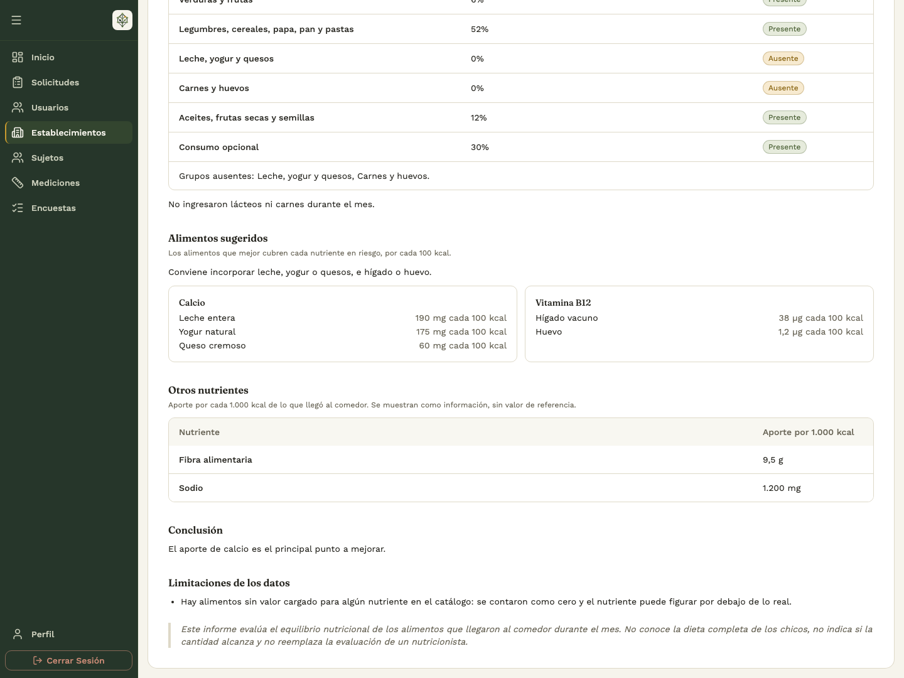
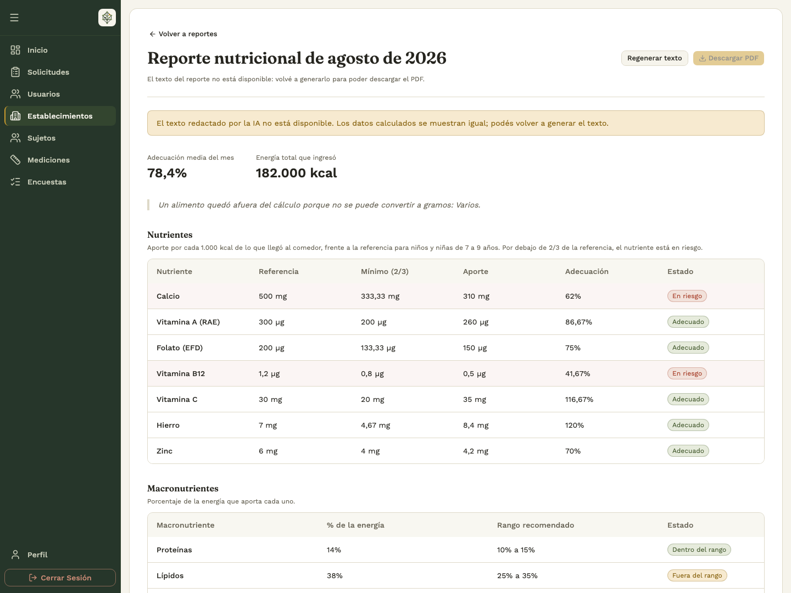
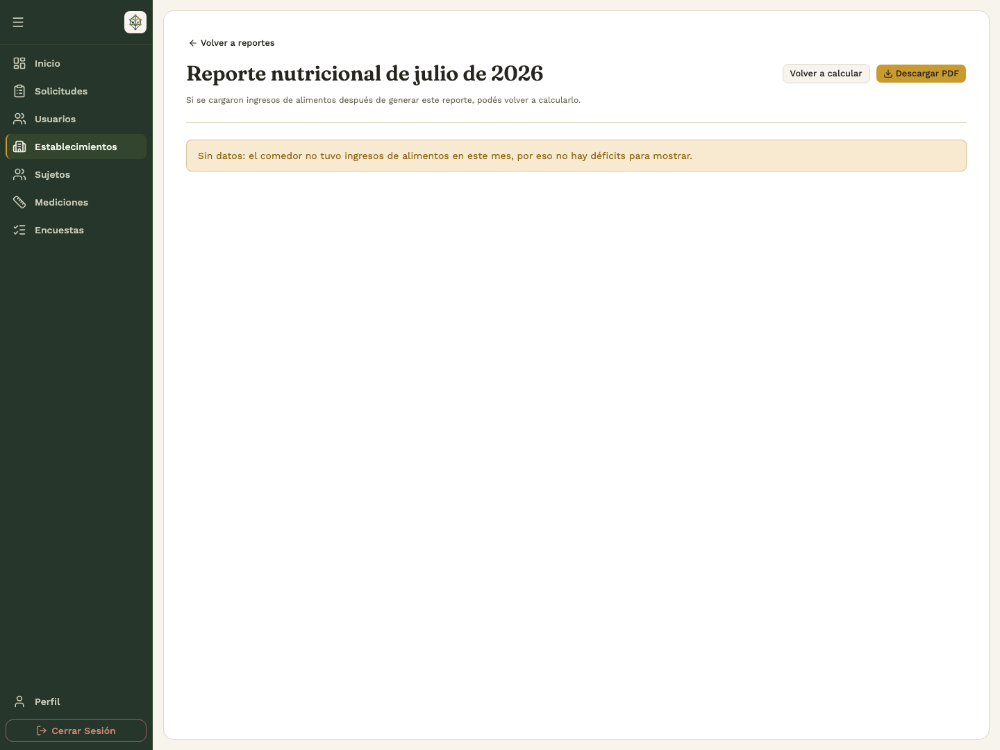

# 4. Nutrir

## 4.1 Consultar existencias

Abrí **Establecimientos → comedor → Stock**. La tabla muestra cantidades, categorías, unidades y última actualización. Aplicá los filtros y usá **Exportar CSV** para descargar la consulta. Verificá el comedor antes de registrar movimientos.

El catálogo determina la unidad: kilogramos, litros o unidades. Registrá cada cantidad en la unidad indicada. Si una consulta no muestra alimentos, quitá los filtros y revisá si hay existencias.

## 4.2 Registrar movimientos desde el backoffice

**Quién:** administrador o analista con acceso a las acciones correspondientes. **Dónde:** ficha del establecimiento → **Stock → Registrar movimiento**.

1. Elegí si se trata de un ingreso o un egreso de stock.
2. Completá fecha, alimentos, cantidades y comentarios según el formulario.
3. Si el movimiento es un egreso, especificá hacia dónde va el stock. Si es un ingreso, indicá de dónde proviene y aclará si es un aporte único o recurrente.
4. Hacé clic en **Guardar movimiento** y andá al **Historial de Movimientos**, donde podés hacer clic sobre el registro para verificarlo y ver todo su detalle.

Si se informa que el movimiento ya estaba registrado, abrí el guardado y revisalo antes de volver a cargarlo.

## 4.3 Consultar historial y detalle

En la ficha del establecimiento, elegí **Stock → Historial de Movimientos**.

1. Filtrá por dirección del movimiento, fechas, alimento y las opciones disponibles.
2. Comprobá que la fecha inicial no sea posterior a la final.
3. Abrí un ingreso o egreso para revisar fecha, responsable, comentarios, alimentos, cantidades y unidad.
4. Si no encontrás un movimiento, quitá los filtros y comprobá el establecimiento.

## 4.4 Generar o consultar un reporte nutricional mensual

**Quién:** administrador o analista. **Dónde:** **Establecimientos → comedor → Reporte nutricional**.

1. Comprobá el nombre del comedor. El listado muestra los meses guardados y su estado: **Completo**, **Sin texto** o **Sin datos**.
2. Para consultar uno existente, abrí su fila o elegí **Más acciones → Ver reporte**. Podés cambiar el orden entre **Más recientes primero** y **Más antiguos primero**.
3. Para preparar otro mes, tocá **Generar nuevo reporte** y elegí el **Mes del reporte**. Solo se ofrecen meses ya cerrados; el mes actual todavía no se puede generar.
4. Si ese mes ya tiene un reporte, elegí **Ver reporte** para abrirlo sin volver a generarlo.
5. Si no existe, elegí **Generar reporte** y esperá sin cerrar la pantalla. Al terminar se abre el resultado.

El reporte analiza los **ingresos de alimentos del mes elegido**. No representa los egresos, el stock restante ni el consumo individual de una persona. Consultar un reporte guardado no vuelve a generar el texto ni registra movimientos.

## 4.5 Leer los resultados del reporte

1. Confirmá el mes del encabezado. Para comprobar el comedor, volvé al listado de reportes de su ficha. Revisá **Adecuación media del mes**, **Energía total que ingresó** y el resumen.
2. En **Nutrientes**, compará el aporte por cada 1.000 kcal con la referencia y el estado **En riesgo** o **Adecuado**. La pantalla identifica la población de referencia; no la confundas con una evaluación clínica de cada sujeto.
3. Revisá **Macronutrientes** y sus rangos, y **Grupos de alimentos (GAPA)** para ver qué grupos aparecen o faltan.
4. Consultá **Alimentos sugeridos** para los nutrientes en riesgo. Son sugerencias del reporte; no agregan alimentos al stock ni registran pedidos.
5. Leé **Otros nutrientes**, la conclusión y **Limitaciones de los datos** cuando estén disponibles. Si se avisa que un alimento quedó afuera por falta de conversión a gramos, tenelo en cuenta al interpretar el resultado.

## 4.6 Descargar el reporte y resolver estados pendientes

Para guardar una copia, elegí **Descargar PDF** desde el reporte o desde **Más acciones** en el listado. Comprobá el mes del archivo antes de compartirlo.

| Situación                                 | Qué hacer                                                                                                                                                                                            |
| ----------------------------------------- | ---------------------------------------------------------------------------------------------------------------------------------------------------------------------------------------------------- |
| **Sin texto**                             | Los datos calculados se pueden consultar, pero falta el texto de la IA. Abrí el reporte y elegí **Regenerar texto**. El PDF permanece deshabilitado hasta que el texto esté disponible.              |
| **Sin datos**                             | No se registraron ingresos de alimentos para ese mes. No significa que todos los nutrientes sean adecuados. Si después se cargaron ingresos correspondientes a ese mes, elegí **Volver a calcular**. |
| El recálculo sigue sin datos              | El aviso **Sin cambios** confirma que ese mes continúa sin ingresos; revisá las fechas de los movimientos.                                                                                           |
| El mes todavía no terminó                 | Elegí un mes cerrado.                                                                                                                                                                                |
| Se alcanzó el límite de uso               | Respetá el tiempo de espera que indique el aviso o volvé a intentar más tarde. Podés seguir consultando reportes guardados.                                                                          |
| Faltan conversiones o falló la generación | Revisá el mensaje. Si no hay datos suficientes para calcular, pedí al equipo que revise los alimentos; si hubo un error temporal, reintentá cuando corresponda.                                      |
| No se descarga el PDF                     | Comprobá que el reporte tenga texto y revisá el aviso de descarga antes de reintentar.                                                                                                               |

Generar, regenerar texto o volver a calcular son acciones explícitas y pueden estar sujetas a límites de uso. Evitá repetirlas mientras la pantalla muestra **Generando…** o **Calculando…**.

